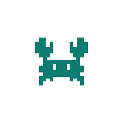
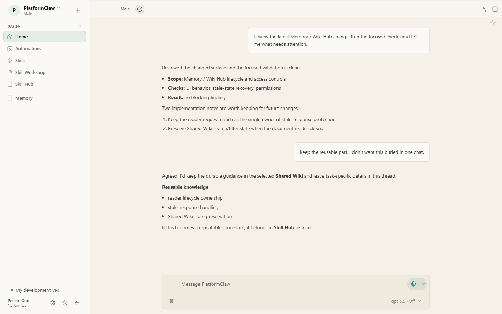
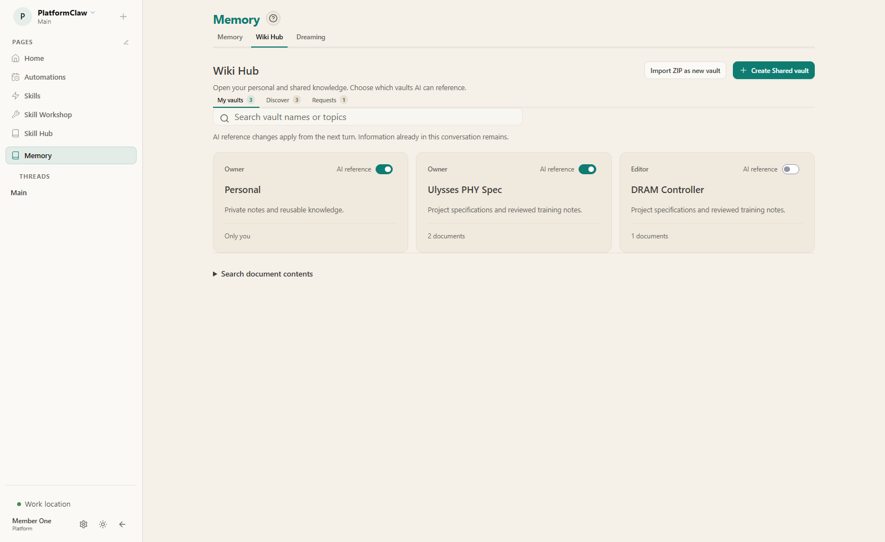
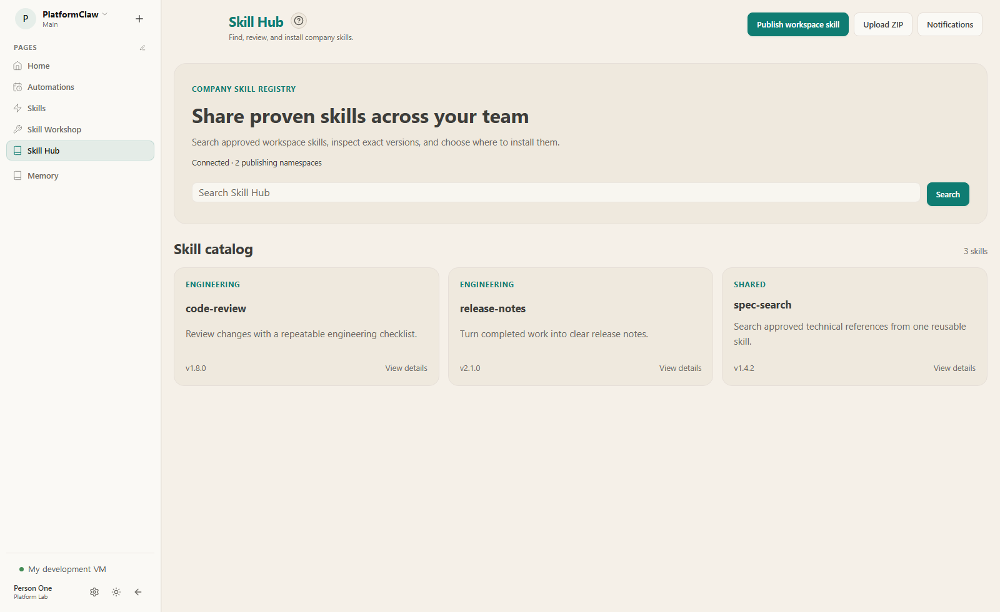

<div align="center">



# PlatformClaw

**Enterprise AI agents for engineering teams.**

Personal agents · Team Spaces · Wiki Hub · Skill Hub · Managed execution

[Architecture](docs/platformclaw/index.md) ·
[UI guide](#find-your-way-around) ·
[Wiki Hub](docs/platformclaw/memory-wiki.md) ·
[Skill Hub](docs/platformclaw/skill-hub.md) ·
[Try it](#try-platformclaw) ·
[Security](SECURITY.md) ·
[Development](#development)

[](https://github.com/devSejung/platformclaw/actions/workflows/platformclaw-ci.yml)
[](https://github.com/openclaw/openclaw)
[](LICENSE)

</div>


PlatformClaw turns OpenClaw into a governed, multi-user workspace with enterprise identity,
personal agents, team Spaces, shared knowledge, reusable skills, and managed execution — without turning the
upstream runtime into an enterprise fork.

The login page follows your saved appearance and English/Korean language choice. Its workspace
illustration keeps moving subtly and can be paused.

## One workspace, from request to reusable knowledge

The personal agent workspace is the front door. An engineer can review a change, run the right checks,
pull in approved context, and decide what should remain task-specific versus what should become durable
team knowledge.

<p align="center">
  
</p>

The important part is what happens after the answer: reusable guidance can move into a Shared Wiki,
and repeatable procedures can become managed skills instead of disappearing into one thread.

Use the search button or **Ctrl/Cmd+K** to find a personal conversation by title or message text and
open the matching message. Inside a conversation, **Ctrl/Cmd+F** finds messages in that thread.
Space conversations stay in their owning Space rather than appearing in personal conversation search.

### Team Spaces

Create a Space, invite colleagues, and organize notes in nested pages. Each member opens their own
Agent conversation tabs on a page; shared Q&A and notes help the team recover earlier decisions.
Members' agents can retrieve questions and final answers from authorized Space conversations, while
raw transcripts, tool output, attachments, approvals, and execution stay private to the session owner.
Spaces can span teams without changing the organization hierarchy.

[Space collaboration and access rules →](docs/platformclaw/spaces.md)

## Knowledge and capability that stay with the team

### Wiki Hub

Personal and Shared Wikis live next to the agent, with vault discovery, content search, access-aware
AI reference, document lifecycle, and organization permissions.

Open **Memory > Wiki Hub** to discover Wikis, request Reader or Editor access, write documents,
upload Markdown files or folders to Personal Wiki, and follow document links in the graph.
Publish an explicit copy from Personal Wiki to an editable Shared Wiki when it is ready to share.
Select several documents for bulk publication or deletion and review each item's result.
AI reference is a separate choice from read access; selection changes apply from the next Agent turn.
**Memory** searches personal recall, while **Dreaming** shows personal memory consolidation.

<p align="center">
  
</p>

### Skill Hub

Repeatable engineering work becomes a searchable internal catalog with explicit versions, ownership,
visibility, install targets, and scanning policy.

Inspect a version before installing it into **Basic Workspace** or **My VM Workspace**, independently
of the current chat work location. Publish workspace skills through the same catalog. Authorized
maintainers can edit Hub content and publish a scanned new version; a Hub edit does not silently
replace an already installed workspace copy.

<p align="center">
  
</p>

### Skill Workshop

Draft and improve skills without changing the live instructions immediately. Review proposals and
support files in **Workshop**, evaluate the draft, request a revision when needed, and explicitly
apply the reviewed version to its Basic or VM workspace target. History scan can identify repeatable
work in earlier conversations for review.

> Product screenshots show representative PlatformClaw workflows with synthetic demo data. Layouts
> may differ from the latest UI; the navigation guide below describes the current product surfaces.

## Find your way around

The personal-agent UI exposes the following destinations when available to your account. Use the
help button beside a page title for its workflow. Some secondary destinations appear under **More**
or **Settings** rather than as permanent sidebar rows.

| Destination                     | What you can do                                                                                                                                                                                            |
| ------------------------------- | ---------------------------------------------------------------------------------------------------------------------------------------------------------------------------------------------------------- |
| Home and conversations          | Start or resume personal work, search conversations and message text, use attachments and inline Canvas widgets, and inspect tool progress and approvals.                                                  |
| Spaces                          | Organize pages, shared notes and your own conversation tabs; invite members and search authorized team Q&A through your Agent.                                                                             |
| Memory                          | Switch between personal **Memory**, **Wiki Hub**, and **Dreaming**. Wiki access and AI reference remain separate controls.                                                                                 |
| Skills                          | Read installed instructions and check whether a skill is Ready, Needs Setup, or Disabled.                                                                                                                  |
| Workshop                        | Review, evaluate, revise, and apply proposed skill changes to the intended workspace.                                                                                                                      |
| Skill Hub                       | Search the company catalog, inspect versions, publish skills, and choose an installation target.                                                                                                           |
| Automations                     | Schedule recurring Agent work, run it now, and inspect run history and delivery outcomes.                                                                                                                  |
| Dashboard                       | Review platform activity, trends and busy hours; filter reports and download Excel. **My tokens & cost** opens personal usage analysis. Request messages are not completed tasks, and cost is an estimate. |
| Credentials and MCP in Settings | Save personal service keys and credentials for approved MCP servers. Administrators own the MCP registry and tool policy; saving a key does not verify authentication with the service.                    |
| Organization in Settings        | View Team, Group and Part membership, request to join, and manage structure, requests or audit records within your delegated permissions.                                                                  |
| VM administration in Settings   | Administrators manage trusted SafeConnect endpoints and VM hosts through focused operation dialogs. Employees choose their own **Work location**.                                                          |
| Announcements and guidance      | Read published notices; administrators manage announcements in Settings. Login includes a Guide video when configured, and Appearance controls the saved theme.                                            |

Temporary connection loss keeps the signed-in employee shell and recoverable local work available
while the client reconnects. An expired or revoked login requires signing in again.

## Choose where work runs

Open **Work location** to use the managed **Basic** environment or connect your development VM through
SafeConnect. A successful first VM connection selects the VM; later switches do not synchronize files
between environments. Personal memory and Wiki stay with the Gateway-hosted Agent.

Use the chat's **Session Files** workspace browser to upload and download Basic workspace files,
up to 16 MiB per file. These actions are unavailable for assigned-VM workspaces. Chat attachments and
generated downloads are separate conversation artifacts. Neither path turns the employee browser into
an unrestricted view of server files.

When a task requires a personal service key, use the contextual **Add key** action or **Settings >
Credentials**, then return to the original conversation to continue. Never paste a key into chat.
MCP credentials have their own **Settings > MCP** surface.

## Why PlatformClaw exists

- **Personal by default.** Each employee gets a stable personal agent, isolated browser/session boundary,
  and user-scoped workspace context instead of sharing one operator identity.
- **Knowledge survives the thread.** Personal and Shared Wikis make durable engineering context searchable,
  permission-aware, and explicitly selectable for AI reference.
- **Collaboration keeps its owner.** Spaces share project notes and eligible Q&A without sharing another
  employee's Agent session, tools, or VM access.
- **Capability becomes reusable.** Skill Hub and enterprise MCP turn repeatable work into managed team
  capability instead of prompt fragments copied between chats.
- **Execution has boundaries.** Work runs only on approved Docker or assigned development-VM targets while
  durable credentials stay behind server-side policy and broker boundaries.

## OpenClaw underneath, enterprise policy around it

PlatformClaw deliberately keeps the generic agent runtime upstream.

**PlatformClaw owns** enterprise identity, browser authorization, organization access, personal-agent
provisioning, shared-knowledge policy, enterprise credentials, and execution targets.

**OpenClaw owns** the Gateway, sessions, tools, skills, channels, plugin contracts, and the generic agent
runtime they provide.

That ownership split is what lets PlatformClaw add enterprise product behavior without making every
upstream sync a rewrite.

[Read the architecture →](docs/platformclaw/index.md)

## Explore

- **Knowledge:** [Wiki Hub](docs/platformclaw/memory-wiki.md)
- **Collaboration:** [Team Spaces](docs/platformclaw/spaces.md)
- **Skills:** [Skill Hub](docs/platformclaw/skill-hub.md) · [Skill Hub policy](docs/platformclaw/skill-hub-policy.md)
- **Organization:** [Organization architecture](docs/platformclaw/organization-architecture.md)
- **Execution:** [VM execution policy](docs/platformclaw/vm-execution-policy.md) · [Credential broker](docs/platformclaw/credential-broker.md)
- **Operations:** [Deployment and operator guide](docker/platformclaw-runtime/OPERATIONS.ko.md) · [VM administration](docs/platformclaw/vm-administration.md)
- **Messaging:** [Knox integration contract](docs/platformclaw/knox-proxy-spec.md)
- **Downstream maintenance:** [Upstream and migration status](docs/upstream/status.md)

<details>
<summary><strong>Security model</strong></summary>

PlatformClaw treats enterprise boundaries as product behavior, not UI hints.

- Browser sessions use opaque server-managed tokens; authority is resolved on the server.
- Organization membership and Wiki access are re-evaluated through shared authorization services.
- Durable VM credentials are stored as encrypted envelopes and cross the execution boundary through a bounded broker path.
- Browser users never receive Gateway operator credentials, stored passwords, or credential ciphertext.
- Enterprise-only behavior stays downstream whenever OpenClaw already exposes a suitable extension seam.

See [employee authentication](docs/platformclaw/employee-auth.md),
[organization architecture](docs/platformclaw/organization-architecture.md),
[VM execution policy](docs/platformclaw/vm-execution-policy.md), and [SECURITY.md](SECURITY.md).

</details>

## Try PlatformClaw

### Windows preview

With Git, a supported Node.js runtime, Python, and Corepack available, run these commands from the
repository in PowerShell:

```powershell
.\scripts\platformclaw-windows.ps1 -Action Doctor
.\scripts\platformclaw-windows.ps1 -Action Start
```

The launcher fetches the latest `origin/main` into an isolated cache and starts synthetic employee
authentication, a private Gateway, and the Control service. It opens
`http://127.0.0.1:19001/platformclaw/login`.

| Demo role     | Account      | Password        |
| ------------- | ------------ | --------------- |
| Employee      | `person.one` | `test-password` |
| Administrator | `admin.user` | `test-password` |

These are disposable local fixtures. Real model replies require an approved OpenAI-compatible
provider configuration. To preview the current committed branch instead of `origin/main`, pass
`-SourceRef HEAD`; uncommitted edits are excluded in both cases. See the
[Windows preview guide](docs/platformclaw/windows-main-preview.md) for prerequisites and shutdown.

### Linux Docker and enterprise deployment

For the full local VM workflow, start Docker Desktop in Linux-container mode and run
`.\scripts\platformclaw-vm-preview.ps1` from a clean, complete checkout. The
[manual VM preview](docs/platformclaw/manual-vm-preview.md) covers registration, credentials,
connection checks, and target switching with Fake SafeConnect. Enterprise network and authentication
validation remains a separate step.

Production uses the [PlatformClaw runtime bundle](docker/platformclaw-runtime/README.md), with
installation, upgrades, backups, CA setup and recovery in the
[operator guide](docker/platformclaw-runtime/OPERATIONS.ko.md). Gateway and Control use the host's
regular Docker daemon; Agent sandboxes use a separate rootless daemon. Only Control is published,
on port `19002` by default. Restrict its host-wide bind with the approved firewall or reverse proxy;
keep Gateway private. The repository-root Compose file is the upstream OpenClaw deployment.

**Upgrading from retired Organization Memory:** review the
[Wiki Hub cutover](docs/platformclaw/memory-wiki.md#upgrade-deletes-retired-organization-knowledge)
before rollout. Startup deletes the old organization knowledge records; it does not migrate them
into Shared Wikis. Personal Memory, Personal Wiki and Shared Wiki are preserved.

## Development

This repository is a pnpm workspace. Windows is supported as the development host; the deployment/runtime
target is Linux Docker.

Use the Node.js ranges and pinned pnpm version in `package.json`. In a normal, complete checkout:

```bash
pnpm install --frozen-lockfile
pnpm build
pnpm ui:build
```

For uncommitted UI work, `pnpm ui:dev` provides source HMR against a real Gateway. For a deterministic
layout preview without a backend, use the existing fixtures:

```bash
pnpm ui:fixture-preview -- --list
pnpm ui:fixture-preview -- platformclaw-wiki-hub --theme platformclaw --mode light
```

Fixture previews use synthetic data and do not prove authentication or backend persistence. A Gateway
serves the built `dist/control-ui` bundle, so rebuild with `pnpm ui:build` before checking source edits
through that Gateway. See [preview modes](docs/platformclaw/windows-main-preview.md#choose-the-lightest-preview-that-fits).

On Windows linked worktrees, **do not run `pnpm install`** or restore, checkout, or reset tracked
`node_modules` paths: workspace junctions can point back into the source checkout. Reuse the primary
checkout toolchain through the repository wrappers, or use the isolated Windows preview snapshot.

For a focused PlatformClaw change:

```bash
node scripts/platformclaw-check.mjs --changed --quick
```

Before pushing a PlatformClaw PR:

```bash
node scripts/platformclaw-check.mjs --changed
```

Build and export the Linux Docker release images from a clean, complete checkout with
`pnpm platformclaw:build`; archives default to `.artifacts/platformclaw/`. Inspect build options with
`node scripts/platformclaw-build.mjs --help`.

Read [CONTRIBUTING.md](CONTRIBUTING.md) and [PLATFORMCLAW.md](PLATFORMCLAW.md) before changing shared
OpenClaw surfaces.

## Upstream relationship

PlatformClaw is maintained as an enterprise-oriented downstream of
[OpenClaw](https://github.com/openclaw/openclaw). If you are looking for the general-purpose personal
OpenClaw distribution, installers, community channels, or public documentation, use the
[upstream repository](https://github.com/openclaw/openclaw).

> [!NOTE]
> PlatformClaw is under active enterprise deployment hardening. Implementation and rollout documents
> remain authoritative for production-readiness and cutover status.

## License

Licensed under the [MIT License](LICENSE). See [THIRD_PARTY_NOTICES.md](THIRD_PARTY_NOTICES.md) for
incorporated or adapted third-party code and attribution.
